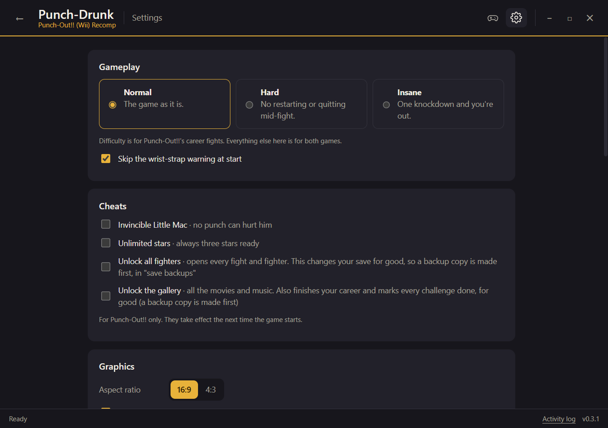

# Punch-Drunk: Punch-Out (Wii) Recomp

A portable launcher for **Punch-Out!!** (Wii, 2009) and **Doc Louis's Punch-Out!!** (WiiWare, 2009) on PC (Windows, Linux and Steam Deck).

This is a fork of [POW: Recompiled](https://gitlab.com/fist-in/POW-Recompiled) by fist-in. The original author did great
work on the port itself, but the install process could be troublesome. This fork makes it a simple unzip-and-run
program, adds a few cheats, and fixes building and loading from external SSDs.

> **Unofficial fan project. Not affiliated with or endorsed by Nintendo.** It includes no game files. You bring your own
> disc image and WAD. Punch-Out!! and Doc Louis's Punch-Out!! are © Nintendo.


## What's different from the original

- **Portable.** Unzip it and run it. No installer. Everything stays in its own folder.
- **Easier setup.** One launcher for both games. Doc Louis's installs straight from your own WAD file, with no emulator.
  The build tools are fetched for you, and the Visual C++ runtime is included.
- **Works on external drives**, including exFAT SSDs.
- **Cheats** (all off by default): Invincible Little Mac, Unlimited stars, Unlock all fighters, Unlock the gallery.
- **Small extras:** anti-aliasing, clearer resolution labels, aspect ratio locked by default, a frame-rate switch,
  and Escape opens the Exit box.

The full list is in [FORK_CHANGES.md](FORK_CHANGES.md).



## How to use it

Download from [Releases](../../releases/latest):

| Your computer | Download |
| --- | --- |
| Windows 10/11 | `Punch-Drunk-1.0.0-Windows-x64.zip` (unzip it, run `Punch-Drunk.exe`) |
| Linux (Ubuntu 24.04 tested) | `Punch-Drunk.AppImage` |
| Steam Deck | `Punch-Drunk-SteamDeck.AppImage` (run it in Desktop Mode) |

1. Put it in a folder with a plain path (letters, numbers, spaces), for example `C:\Games\Punch-Drunk`. On Linux and
   Steam Deck, make the AppImage executable first. It keeps everything beside itself, so give it its own folder.
2. Run it.
3. Press **Set up** on a game, pick your disc image (Punch-Out!!) or your WAD (Doc Louis's), and let it build. The first
   build takes a while and needs about 10 GB of free space. After that it's just **Play**.

Doc Louis's needs the Wii common key from your own console (the `keys.bin` from a BootMii backup, or paste the key).
It is used once to unpack the WAD and is never saved.

**Linux only:** the build needs some packages first. On Ubuntu or Debian:

```
sudo apt install git cmake ninja-build clang lld llvm make pkg-config curl libfuse2t64 libicu74 libx11-dev libxext-dev libxrandr-dev libxcursor-dev libxfixes-dev libxi-dev libxss-dev libxtst-dev libxinerama-dev libxkbcommon-dev libwayland-dev wayland-protocols libdecor-0-dev libegl-dev libgl-dev libgles-dev libdrm-dev libgbm-dev libvulkan-dev libpulse-dev libpipewire-0.3-dev libasound2-dev libudev-dev libdbus-1-dev
curl -sSL https://dot.net/v1/dotnet-install.sh | bash -s -- --channel 8.0
```

The Steam Deck version needs nothing installed: it carries its own build tools.

Controls: arrow keys or WASD to move, J and K to punch, L or Space for the star punch, Enter to pause. Controllers work
too, and everything can be changed in the launcher.

## Status

- **Windows** is the version that has been played and tested, on the author's own Windows 11 PC. Other graphics cards
  and Windows versions are untested.
- **Linux and Steam Deck** were only tested in WSL (Ubuntu 24.04 on Windows): the launcher starts, Punch-Out!! builds
  from a disc and runs at 60 fps. Nobody has played on a real Linux PC or a real Steam Deck yet, and Doc Louis's
  hasn't been built on Linux. Treat them as experimental, and please report what happens.
- The Windows program is not code-signed, so SmartScreen or your antivirus may warn the first time you run it.
- The two unlock cheats change your save file for good. The launcher makes a backup copy first.

## Credits

- [POW: Recompiled](https://gitlab.com/fist-in/POW-Recompiled) by fist-in: the port, the launcher and the Archipelago support.
- [WiiCompiled](https://github.com/patchzyy/wiicompiled), the recompiler the port is built on.
- SMS Launcher by Chase Myers, the launcher's starting point. Controller glyphs by Arks (CC BY 4.0). Open Sans (SIL OFL).
  nod by Luke Street. Full list in `THIRD_PARTY_NOTICES.txt`.
- Built with help from Claude (Anthropic); designed and tested by Mr-Shizzy.

## License

The launcher is MIT, like the original. See [LICENSE](LICENSE). The `port/` folder (the changes to WiiCompiled) is
GPL-3.0, as WiiCompiled is. See [port/LICENSE](port/LICENSE).
