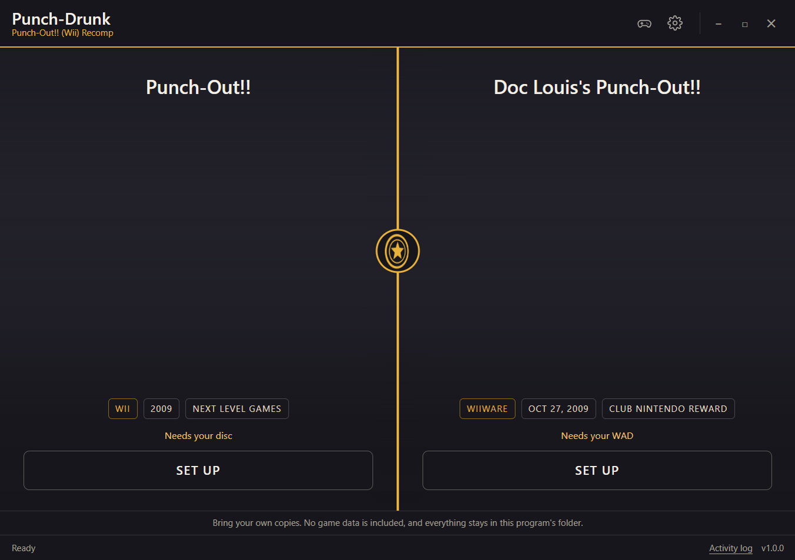

# Punch-Drunk: Punch-Out (Wii) Recomp

**Punch-Out!!** and **Doc Louis's Punch-Out!!** (Wii) recompiled for Windows, Linux, and Steam Deck.

A fork of [POW: Recompiled](https://gitlab.com/fist-in/POW-Recompiled) by fist-in. The original author did great work on the port. This fork makes it fully portable, adds cheats, simplifies the setup process, fixes loading on external SSDs.

> Unofficial fan project. Not affiliated with Nintendo. No game files are included.

## Download

Get it from [Releases](../../releases/latest).

| Your computer | File |
| --- | --- |
| Windows 10/11 | `Punch-Drunk-1.1.0-Windows-x64.zip` |
| Linux (experimental) | `Punch-Drunk.AppImage`, see [LINUX.md](LINUX.md) |
| Steam Deck (experimental) | `Punch-Drunk-SteamDeck.AppImage`, see [LINUX.md](LINUX.md) |

## How to use it

You need your own copies of the games. Only the **USA versions** work.

1. Unzip it to a folder with a plain path, like `C:\Games\Punch-Drunk`.
2. Run `Punch-Drunk.exe`.
3. Press **Set up** on a game and pick your disc image (Punch-Out!!) or your WAD (Doc Louis's). The first build takes a
   while and needs about 10 GB free. After that, just press **Play**.

Doc Louis's also needs the Wii common key from your own console (`keys.bin` from a BootMii backup). It's used once to
unpack the WAD and never saved.

## What's different from POW: Recompiled

- **Portable.** No installer, everything stays in one folder.
- **Easier setup.** One launcher for both games, no emulator needed for Doc Louis's.
- **Works on external drives**, including exFAT SSDs.
- **Windows setup needs no internet**, and the build files are removed again afterwards. If your PC is missing Microsoft's Visual C++ runtime (most have it), the launcher downloads it once.
- **Updates when you say so.** The launcher checks GitHub for a newer version (switch it off in Settings) and offers **Update now** or **Remind me later**. Your games, saves and settings stay put. On Linux and Steam Deck it just links the download page.
- **Cheats** (off by default): invincible, unlimited stars, unlock all fighters, unlock the gallery.
- **High refresh rate (experimental,** off by default): extra in-between frames for screens faster than 60 Hz. The game's speed doesn't change. Not yet tried on such a screen.

The full list is in [FORK_CHANGES.md](FORK_CHANGES.md).

## Status

Tested on the author's Windows 11 PC. Linux and Steam Deck were only tested in WSL.
The Windows exe is not code-signed, so SmartScreen or your antivirus may throw a warning. The two unlock cheats permanently alter your save (a backup is made first).

## Credits

- [POW: Recompiled](https://gitlab.com/fist-in/POW-Recompiled) by fist-in, and [WiiCompiled](https://github.com/patchzyy/wiicompiled), which it's built on.
- Other third-party credits are in [THIRD_PARTY_NOTICES.txt](launcher/packaging/THIRD_PARTY_NOTICES.txt).

## AI Disclosure

This project utilized AI to assist with some code, as well as debugging.

## License

Punch-Drunk changes Copyright (C) 2026 Mr-Shizzy.

The launcher is MIT ([LICENSE](LICENSE)). The `port/` folder is GPL-3.0, like WiiCompiled ([port/LICENSE](port/LICENSE)).
